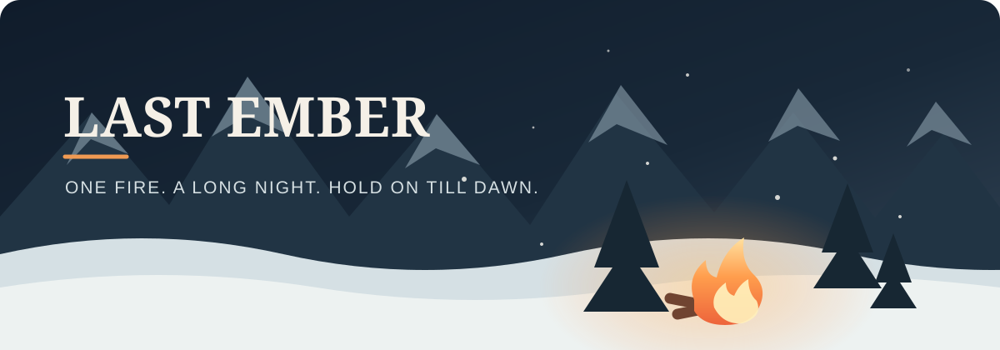

  

  <strong>A quiet world. A hungry fire. Something moving beyond the light.</strong> 
  A bite-sized winter survival game about making it through one more night.

  <a href="#play"><strong>▶ &nbsp; PLAY</strong></a> &nbsp;　·　&nbsp;
  <a href="#the-night"><strong>THE NIGHT</strong></a> &nbsp;　·　&nbsp;
  <a href="#controls"><strong>CONTROLS</strong></a> &nbsp;　·　&nbsp;
  <a href="#browser-extension"><strong>BROWSER EXTENSION</strong></a>

 

## One more night

The world has gone quiet. Snow swallows the trail, the dark presses close, and the fire is all that keeps the wolves back.

In **Last Ember**, each night is a fight to see the dawn. Leave the warmth to gather scattered logs, then carry them back before the flames die. The light is safety, but only while you can keep it alive. Survive the night and choose an upgrade. Stay out there long enough, and the cold will have to wait one more night.

<em>Just you, the snow, and one more night.</em>

<table>
  <tr>
    <td align="center" width="25%"><strong>01 &nbsp; TEND</strong> The fire is fading.</td>
    <td align="center" width="25%"><strong>02 &nbsp; VENTURE</strong> Find wood in the dark.</td>
    <td align="center" width="25%"><strong>03 &nbsp; RETURN</strong> Bring it back alive.</td>
    <td align="center" width="25%"><strong>04 &nbsp; ENDURE</strong> Reach dawn. Grow stronger.</td>
  </tr>
</table>

<code>🌙 &nbsp; KEEP THE FIRE ALIVE &nbsp; → &nbsp; 🪵 GATHER WOOD &nbsp; → &nbsp; 🐺 OUTLAST THE NIGHT &nbsp; → &nbsp; 🌅 CHOOSE AN UPGRADE</code>

## The night

Keep the fire burning until dawn. Its fuel drains as the night wears on, so venture out for logs and bring them back. The fire’s ring of light is your shelter: wolves prowl beyond it, and the nights grow longer and more dangerous as you survive.

Make it to dawn and choose one of two upgrades. Then the light begins to fade again.

## Find your way

| What you need | How |
|:--|:--|
| Walk | **WASD**, **arrow keys**, or tap and drag |
| Pause / resume | **P** or **Esc** |
| Change sound | **M** or the speaker button |
| Choose an upgrade at dawn | **1** or **2**, or tap a card |
| Open the help | **?** button |

The game pauses when its tab loses focus. Your best run and sound setting are saved locally in the browser. Sound starts after your first input, as browsers require a user gesture before audio can play.

## Play

### Open the standalone game

Open [`last-ember.html`](last-ember.html) in a modern browser. The game is self-contained and needs no server, installation, account, or internet connection.

### Install the browser button

The [`last-ember-extension`](last-ember-extension/) folder contains an unpacked extension for Chrome and Brave. Install it once, then launch the locally bundled game from your toolbar—even offline.

1. Open `chrome://extensions` in Chrome or `brave://extensions` in Brave.
2. Turn on **Developer mode**.
3. Choose **Load unpacked** and select the `last-ember-extension` folder.
4. Pin **Last Ember** in the Extensions menu for quick access.

See the [extension setup guide](last-ember-extension/README.md) for more details.

<strong>LAST EMBER</strong> &nbsp;·&nbsp; MIDNIGHT <code>#182838</code> &nbsp; FROST <code>#D5E0E4</code> &nbsp; EMBER <code>#ED633B</code> &nbsp; FIRELIGHT <code>#FFBF69</code>

